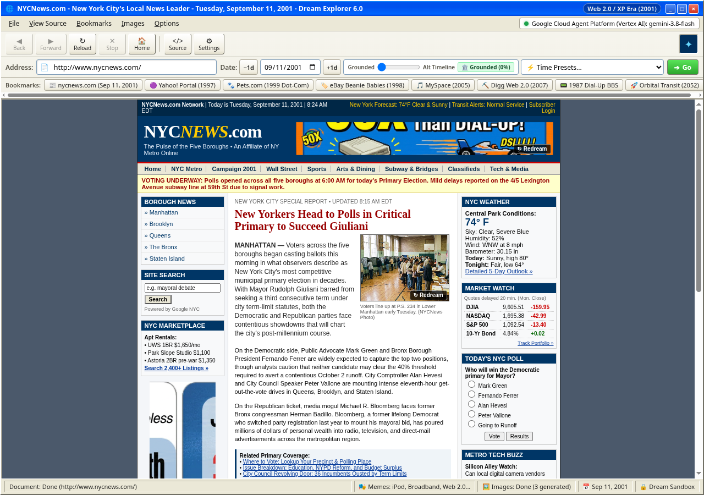

# Browser of Dreams

**A retro web simulator and temporal AI dream engine.** Pick any URL and any date from
1969 to 2150, and a language model writes an era-appropriate webpage on the fly. An
image model can add period banner ads, editorial photos, or text-mode art.



The screenshot is real output: `nycnews.com` on September 11, 2001, generated in
"Grounded" mode.

## Try it

Open the live demo at
[https://joshuaeroman.github.io/browserofdreams/](https://joshuaeroman.github.io/browserofdreams/),
or run it locally:

```bash
git clone <your-fork-url>
cd browserofdreams
npm install
npm run serve      # http://localhost:8765
```

`dist/` is prebuilt. Run `npm run build` only after changing `src/`.

## Bring your own API keys

The app has no backend. It calls the model providers directly from your browser, so you
need at least one provider key, or a local OpenAI-compatible server. Open
**Settings > Providers**, paste a key (or save a local endpoint), and choose the text and
image providers in the bottom bar.

| Provider | Get a key | Notes |
| --- | --- | --- |
| OpenRouter | https://openrouter.ai/keys | Largest catalog; text and image models. |
| Command Code | https://commandcode.ai/studio/ | Text only. Pair it with a separate image provider. |
| Google AI Studio | https://aistudio.google.com/app/apikey | Gemini text and image models. |
| Google Cloud Vertex AI | Google Cloud console | API key or short-lived access token; re-paste tokens when they expire. |
| Local LLM (OpenAI-compatible) | No key needed | Ollama, LM Studio, llama.cpp, etc. Default endpoint `http://localhost:11434/v1`; the server must allow this page's origin (Ollama: set `OLLAMA_ORIGINS`). Text only. |

You can configure more than one provider and switch between them at any time.

### Key storage and privacy

- API keys are saved in your browser's `localStorage` in plaintext and sent only to the
  provider you selected. There is no Browser of Dreams server.
- Use a dedicated key, avoid shared computers, and rotate keys you have used here.
- Generated pages, images, memes, and recent history are cached locally. Clear them with
  **Settings > Clear Cached Pages & Images**.
- Dream pages render inside a sandboxed iframe. Treat generated content as fiction and
  never enter real credentials into a dreamed page.

## What you can do

- **Travel the web.** Enter a URL and a date; the era engine picks a period theme and the
  text model writes matching HTML, CSS, and JavaScript.
- **Make period imagery.** Use a dedicated image model, or let the text model produce
  pixel art or SVG.
- **Set the reality dial.** Go from strict historical grounding to alternate-history
  invention.
- **Watch it stream.** Pages arrive through a dial-up transfer dialog, and Recent History
  lets you reopen past dreams.
- **Install it.** The PWA works offline for the app shell; API traffic is never cached.

## Development

```bash
npm test          # build and run the test suite
npm run build     # rebuild dist/
npm run watch     # rebuild on change
npm run icons     # regenerate PWA icons (requires Python)
npm run mock:llm  # OpenAI-compatible mock server on 127.0.0.1:11434 for the Local LLM provider
```

When changing the app shell, bump `CACHE_NAME` in `sw.js` and the matching `?v=` values
for `dist/app.js` and `dist/app.css` in `index.html` and `PRECACHE_ASSETS`, then commit
`dist/`.

## Disclaimer

All pages, ads, and memes are AI-generated historical fiction. "Grounded" mode aims for
accurate details for the chosen date, but it can still be wrong.

## License

[MIT](LICENSE) (c) The Browser of Dreams Authors. Generated content belongs to whoever
dreamed it; mind your provider's terms.
